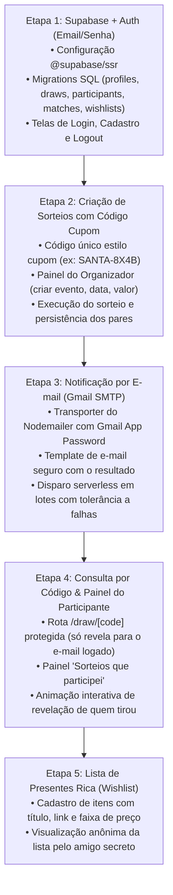
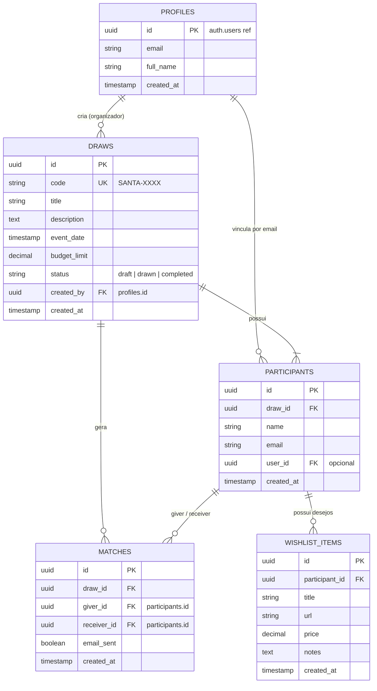

# 🗺️ Roadmap de Produto: Secret Santa (Amigo Secreto)

Este documento descreve o planejamento estratégico, a arquitetura e as etapas de evolução do projeto **Secret Santa**, projetado para deploy serverless na **Vercel** com **Next.js 15**, **Supabase (PostgreSQL + Auth)**, **Nodemailer (Gmail SMTP)** e **Tailwind CSS v4**.

---

## 🧭 Visão Geral das Etapas

---

## 🔒 Princípios de Privacidade e Regras de Negócio

1. **Privacidade Absoluta do Sorteio**:
   - O organizador **não** deve ter acesso à lista de quem tirou quem após o sorteio, preservando a surpresa para todos.
   - Cada participante só tem acesso ao **seu próprio par** sorteado.
2. **Revelação via Web**:
   - Para consultar o resultado pelo código único na web (`/draw/[code]`), **é obrigatório estar autenticado**. O sistema verifica se o e-mail da sessão atual corresponde ao e-mail de um participante do sorteio.
3. **Revelação via E-mail**:
   - Caso um participante não queira criar conta na plataforma, ele receberá o resultado diretamente em sua caixa de entrada via e-mail enviado pelo Nodemailer.
4. **Formato do Código**:
   - Códigos curtos, legíveis e sem ambiguidades no formato cupom (ex: `SANTA-8X4B`).
5. **Serviço de E-mail**:
   - Configurado para envio via **Gmail SMTP** usando senhas de app (`GMAIL_USER` e `GMAIL_APP_PASSWORD`).

---

## 📊 Modelagem do Banco de Dados (Supabase PostgreSQL)

---

## 📋 Detalhamento das Etapas

### 🔹 Etapa 1: Supabase Base + Autenticação (Email e Senha)
- [x] Instalar `@supabase/supabase-js` e `@supabase/ssr`.
- [x] Criar migrations SQL com tabelas `profiles`, `draws`, `participants`, `matches` e `wishlist_items` com Row Level Security (RLS).
- [x] Implementar utilitários de cliente do Supabase para Server Components, Client Components e Route Handlers.
- [x] Criar páginas e formulários de `/login`, `/register` e Server Action de `signOut`.
- [x] Adicionar middleware Next.js para controle de sessão e proteção de rotas privadas.

### 🔹 Etapa 2: Criação de Sorteios com Código Cupom & Painel do Organizador
- [x] Implementar gerador de código único estilo cupom (ex: `SANTA-9K2F`).
- [x] Criar tela de criação de sorteio (`/dashboard/draws/new`): título, data do evento, valor sugerido e lista inicial de participantes.
- [x] Desenvolver painel do organizador (`/dashboard`):
  - Listagem dos sorteios criados pelo usuário.
  - Página de detalhes para edição antes do sorteio.
  - Botão de disparo do sorteio que aciona a lógica de Derangement e grava os pares no Supabase.

### 🔹 Etapa 3: Notificação por E-mail (Gmail SMTP via Nodemailer)
- [x] Instalar e configurar `nodemailer` e `@types/nodemailer`.
- [x] Implementar cliente Supabase admin server-only (`src/lib/supabase/admin.ts`) para leitura/escrita dos `matches` bupassando RLS.
- [x] Implementar serviço de transporte com Gmail SMTP (`src/server/mail/transporter.ts`).
- [x] Criar template HTML responsivo e temático para o envio dos resultados (`src/server/mail/templates/draw-result-email.ts`).
- [x] Implementar rotina serverless de disparo em lotes com tolerância a falhas e atualização do campo `email_sent` (`src/server/services/email-dispatch-service.ts`).
- [x] Expor Server Action `dispatchDrawEmailsAction` com guards de sessão, ownership e env vars (`src/server/actions/email-actions.ts`).
- [x] Atualizar UI: botão "Enviar E-mails", badges de status por participante (✅ Enviado / ⏳ Pendente) e aviso de env vars faltando.

### 🔹 Etapa 4: Consulta por Código & Painel do Participante
- [ ] Criar rota pública/protegida `/draw/[code]`:
  - Se deslogado: exibe dados gerais do evento (data, valor) e botão para entrar e revelar.
  - Se logado: verifica se o e-mail do usuário é um participante e revela o amigo secreto com animação.
- [ ] Criar aba ou página no dashboard: "Sorteios que participei".
- [ ] Tela de visualização interativa do resultado com segurança estrita.

### 🔹 Etapa 5: Lista de Presentes Rica (Wishlist)
- [ ] Criar interface para o participante cadastrar sugestões de presentes (título, link para loja online, preço estimado e anotações).
- [ ] Integrar a visualização da lista de presentes na tela de revelação do amigo secreto (quem tirou você pode ver sua lista de forma anônima).
- [ ] Adicionar suporte a validação de links externos seguros.

---

## 🔮 Funcionalidades Futuras (Backlog Secundário)
- Restrições de sorteio (ex: casais não tirarem um ao outro).
- Integração de notificações via WhatsApp (Twilio ou Evolution API).
- Suporte a múltiplos idiomas e moedas.

